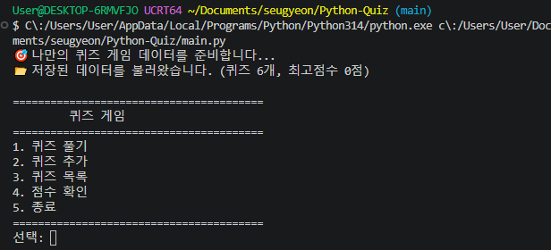
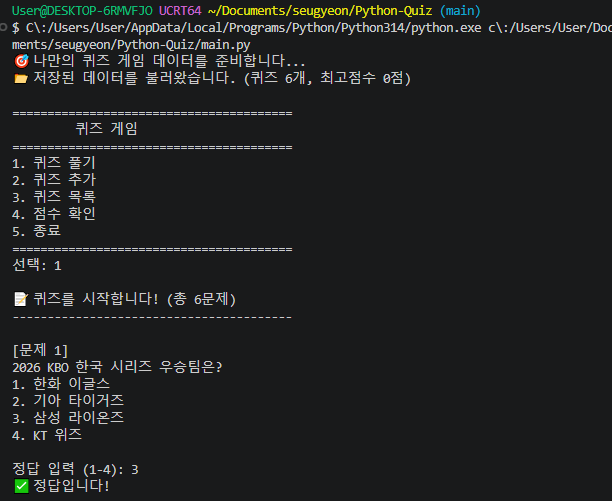
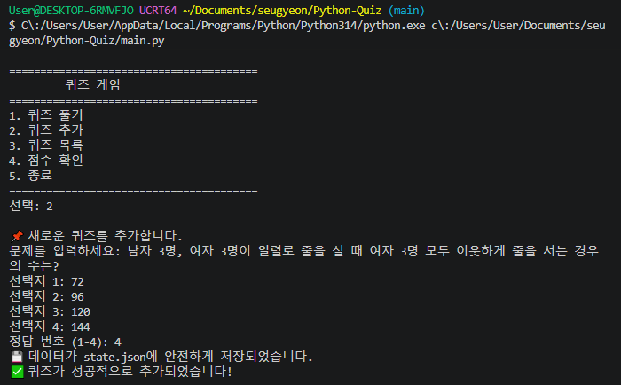
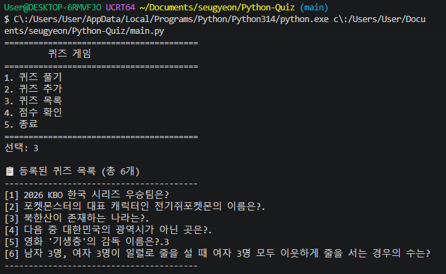
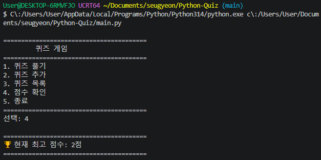

# 퀴즈 게임 (Python Console Game)

## 1. 프로젝트 개요
Python 기본 문법, 객체 지향 프로그래밍(클래스), 파일 입출력(JSON), 그리고 예외 처리를 활용하여 터미널 환경에서 동작하는 콘솔 퀴즈 게임입니다. 프로그램을 종료해도 데이터가 유지되도록 영속성을 부여하고, Git을 통한 버전 관리와 브랜치 워크플로우를 학습하기 위해 제작되었습니다.
## 2. 프로젝트 요구사항 체크리스트
- [x] 동작하는 퀴즈 게임 (메뉴 선택, 풀기, 추가, 목록, 점수 확인, 종료)
- [x] 주제별 퀴즈 5개 이상 포함 (상식 및 대중문화)
- [x] `state.json`을 통한 데이터 영속성 보장 (파일 저장 및 불러오기)
- [x] 객체 지향 프로그래밍 (`Quiz`, `QuizGame` 클래스 분리)
- [x] 예외 처리 구현 (빈칸, 문자 입력, 범위 초과 방어)
- [x] Git 버전 관리 및 브랜치 워크플로우 (`play-feature` 생성 및 `main` 병합)
- [x] 원격 저장소 업로드 (`push`) 및 복제/동기화 (`clone`, `pull`) 실습 완료
## 3. 퀴즈 주제 및 선정 이유
- **퀴즈 주제:** 상식 및 대중문화 퀴즈 (KBO, 포켓몬, 영화 등)
- **선정 이유:** 누구나 직관적으로 풀 수 있는 친숙한 주제를 통해 게임의 재미를 높이고, 사용자가 직접 새로운 문제를 쉽게 추가하며 확장할 수 있도록 구성했습니다.

## 4. 실행 방법
프로그램을 실행하기 위해서는 파이썬(Python 3.10 이상)이 설치되어 있어야 합니다.

```bash
# 프로젝트 폴더로 이동 후 실행
python main.py
```

## 5. 기능 목록
퀴즈 풀기: 등록된 모든 퀴즈를 순서대로 풀고 정/오답 판정 및 최종 점수(최고 점수 갱신)를 확인할 수 있습니다.

퀴즈 추가: 문제, 4개의 선택지, 정답 번호를 입력하여 새로운 퀴즈를 실시간으로 등록하고 state.json에 영구 저장합니다.

퀴즈 목록: 현재 등록된 모든 퀴즈의 목록과 번호를 확인할 수 있습니다.

점수 확인: 기록된 역대 최고 점수를 확인할 수 있습니다.

예외 및 오류 방지: 빈칸 입력, 잘못된 문자(문자열) 입력, 범위를 벗어난 번호 입력 시 프로그램이 종료되지 않고 안전하게 재입력을 유도합니다.

## 6. 파일 구조
```text
python-quiz-game/
├── .gitignore
├── README.md
├── main.py
└── state.json
```

## 7. 데이터 파일 설명 (`state.json`)
- **경로:** 프로젝트 루트 디렉토리 (`./state.json`)
- **역할:** 게임 내 등록된 퀴즈 목록과 사용자의 최고 점수를 영구적으로 저장하고 불러옵니다.
- **스키마 구조:**
  ```json
  {
      "quizzes": [
          {
              "question": "문제 내용",
              "choices": ["선택지1", "선택지2", "선택지3", "선택지4"],
              "answer": 3
          }
      ],
      "best_score": 4
  }

## 8. 실행 결과 예시 화면 
### 1. 메인 메뉴

### 2. 퀴즈 풀기

### 3. 퀴즈 추가

### 4. 퀴즈 목록 확인

### 5. 점수 확인


## 9. 전체 소스 코드 (요구사항 1, 2 증빙)
> 2개 이상의 분리된 클래스(`Quiz`, `QuizGame`)와 파일 영구 저장(`state.json`, `UTF-8`) 로직이 포함된 `main.py`의 전체 코드입니다.

```python
import json
import os

class Quiz:
    def __init__(self, question, choices, answer):
        self.question = question  # 문제 내용
        self.choices = choices    # 선택지 4개 (리스트 형태)
        self.answer = answer      # 정답 번호

class QuizGame:
    def __init__(self, quizzes):
        self.filename = "state.json"
        self.default_quizzes = quizzes 
        
        # 게임 시작 시 파일에서 데이터를 불러옵니다.
        self.quizzes, self.best_score = self.load_data()

    # --- 🌟 파일 불러오기 (Load) ---
    def load_data(self):
        # state.json 파일이 아예 없는 경우 (첫 실행)
        if not os.path.exists(self.filename):
            print("📂 저장된 데이터 파일이 없어 기본 퀴즈를 로드합니다.")
            return self.default_quizzes, 0

        try:
            with open(self.filename, "r", encoding="utf-8") as f:
                data = json.load(f)
                
                # 저장된 퀴즈 딕셔너리 형태를 Quiz 객체로 다시 변환
                loaded_quizzes = []
                for q in data.get("quizzes", []):
                    loaded_quizzes.append(Quiz(q["question"], q["choices"], q["answer"]))
                
                best_score = data.get("best_score", 0)
                
                print(f"📂 저장된 데이터를 불러왔습니다. (퀴즈 {len(loaded_quizzes)}개, 최고점수 {best_score}점)")
                return loaded_quizzes, best_score
                
        except (json.JSONDecodeError, Exception) as e:
            # 파일이 손상되었거나 읽기 오류가 난 경우 예외 처리
            print("⚠️ 데이터 파일이 손상되었거나 읽을 수 없습니다. 기본 데이터로 복구합니다.")
            return self.default_quizzes, 0

    # --- 🌟 파일 저장하기 (Save) ---
    def save_data(self):
        try:
            # Quiz 객체 리스트를 JSON이 이해할 수 있는 딕셔너리 형태로 변환
            quizzes_data = []
            for q in self.quizzes:
                quizzes_data.append({
                    "question": q.question,
                    "choices": q.choices,
                    "answer": q.answer
                })
                
            data = {
                "quizzes": quizzes_data,
                "best_score": self.best_score
            }
            
            with open(self.filename, "w", encoding="utf-8") as f:
                json.dump(data, f, ensure_ascii=False, indent=4)
            print("💾 데이터가 state.json에 안전하게 저장되었습니다.")
        except Exception as e:
            print(f"⚠️ 파일 저장 중 오류가 발생했습니다: {e}")

    def display_menu(self):
        print("\n" + "="*40)
        print("        🎯 나만의 퀴즈 게임 🎯")
        print("="*40)
        print("1. 퀴즈 풀기")
        print("2. 퀴즈 추가")
        print("3. 퀴즈 목록")
        print("4. 점수 확인")
        print("5. 종료")
        print("="*40)

    def display_quiz_list(self):
        print(f"\n📋 등록된 퀴즈 목록 (총 {len(self.quizzes)}개)")
        print("-" * 40)
        if not self.quizzes:
            print("현재 등록된 퀴즈가 없습니다.")
        else:
            for i, quiz in enumerate(self.quizzes, start=1):
                print(f"[{i}] {quiz.question}")
        print("-" * 40)

    def add_quiz(self):
        print("\n📌 새로운 퀴즈를 추가합니다.")
        while True:
            question = input("문제를 입력하세요: ").strip()
            if not question:
                print("⚠️ 문제가 비어있습니다. 다시 입력해 주세요.")
            else:
                break
                
        choices = []
        for i in range(1, 5):
            while True:
                choice = input(f"선택지 {i}: ").strip()
                if not choice:
                    print("⚠️ 선택지 내용은 비워둘 수 없습니다.")
                else:
                    choices.append(choice)
                    break
                    
        while True:
            answer_input = input("정답 번호 (1-4): ").strip()
            try:
                answer = int(answer_input)
                if 1 <= answer <= 4:
                    break
                else:
                    print("⚠️ 1에서 4 사이의 숫자를 입력해 주세요.")
            except ValueError:
                print("⚠️ 잘못된 입력입니다. 숫자로 입력해 주세요.")
                
        new_quiz = Quiz(question, choices, answer)
        self.quizzes.append(new_quiz)
        
        # 🌟 퀴즈 추가 직후 파일에 자동 저장!
        self.save_data()
        print("✅ 퀴즈가 성공적으로 추가되었습니다!")

    def play_quiz(self):
        print(f"\n📝 퀴즈를 시작합니다! (총 {len(self.quizzes)}문제)")
        print("-" * 40)
        
        if not self.quizzes:
            print("등록된 퀴즈가 없습니다. 먼저 퀴즈를 추가해 주세요!")
            return

        score = 0
        total = len(self.quizzes)

        for i, quiz in enumerate(self.quizzes, start=1):
            print(f"\n[문제 {i}]")
            print(quiz.question)
            for j, choice in enumerate(quiz.choices, start=1):
                print(f"{j}. {choice}")
            
            while True:
                answer_input = input("\n정답 입력 (1-4): ").strip()
                if not answer_input:
                    print("⚠️ 값을 입력해 주세요.")
                    continue
                try:
                    user_answer = int(answer_input)
                    if 1 <= user_answer <= 4:
                        break
                    else:
                        print("⚠️ 1에서 4 사이의 숫자를 입력해 주세요.")
                except ValueError:
                    print("⚠️ 잘못된 입력입니다. 숫자로 입력해 주세요.")

            if user_answer == quiz.answer:
                print("✅ 정답입니다!")
                score += 1
            else:
                print(f"❌ 오답입니다. (정답: {quiz.answer}번)")
                
        print("\n" + "="*40)
        print(f"🏆 결과: {total}문제 중 {score}문제 정답!")
        
        if score > self.best_score:
            self.best_score = score
            print("🎉 새로운 최고 점수입니다!")
            
        # 🌟 게임 종료 후 점수가 갱신되었으므로 파일에 자동 저장!
        self.save_data()
        print("="*40)

    def show_best_score(self):
        print("\n" + "="*40)
        print(f"🏆 현재 최고 점수: {self.best_score}점")
        print("="*40)

    def run(self):
        while True:
            self.display_menu()
            choice_input = input("선택: ").strip() 

            if not choice_input:
                print("⚠️ 값을 입력해 주세요.")
                continue
            
            try:
                choice = int(choice_input)
            except ValueError:
                print("⚠️ 잘못된 입력입니다. 1-5 사이의 숫자를 입력하세요.")
                continue
            
            if choice == 1:
                self.play_quiz()
            elif choice == 2:
                self.add_quiz()
            elif choice == 3:
                self.display_quiz_list()
            elif choice == 4:
                self.show_best_score()
            elif choice == 5:
                print("게임을 종료합니다. 플레이해주셔서 감사합니다! 👋")
                break 
            else:
                print("⚠️ 잘못된 입력입니다. 1-5 사이의 숫자를 입력하세요.")

if __name__ == "__main__":
    quiz_list = [
        Quiz("2026 KBO 한국 시리즈 우승팀은?", ["한화 이글스", "기아 타이거즈", "삼성 라이온즈", "KT 위즈"], 3),
        Quiz("포켓몬스터의 대표 캐릭터인 전기쥐포켓몬의 이름은?", ["이상해씨", "파이리", "꼬부기", "피카츄"], 4),
        Quiz("북한산이 존재하는 나라는?", ["일본", "대한민국", "북한", "중국"], 2),
        Quiz("다음 중 대한민국의 광역시가 아닌 곳은?", ["대전", "부산", "수원", "인천"], 3),
        Quiz("영화 '기생충'의 감독 이름은?", ["봉준호", "이창동", "박찬욱", "김기영"], 1) 
    ]
    
    game = QuizGame(quiz_list)
    game.run()